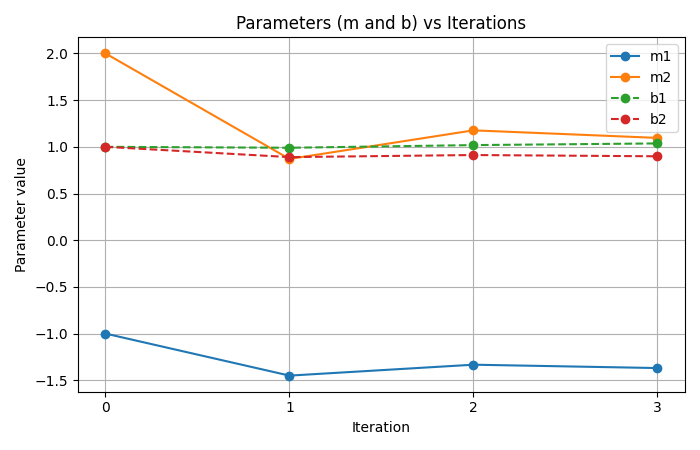
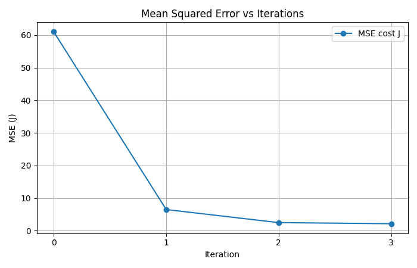

# Formative 3: Probability Distributions, Bayesian Probability and Gradient Descent

This repository contains our group's work for Formative 3. It covers Gaussian mixture modelling with Expectation-Maximization, Bayesian probability on IMDb reviews, and gradient descent for linear regression, done first by hand and then in Python with SciPy.

This README also serves as our presentation guide. All parts are documented in full below. The sections for Parts 1 and 2 are marked for the teammates who own them.

---

## Table of contents

1. [Project overview](#1-project-overview)
2. [Team and contributions](#2-team-and-contributions)
3. [Repository structure](#3-repository-structure)
4. [Getting started](#4-getting-started)
5. [Part 1: Probability distributions (EM)](#5-part-1-probability-distributions-em)
6. [Part 2: Bayesian probability](#6-part-2-bayesian-probability)
7. [Part 3: Gradient descent by hand](#7-part-3-gradient-descent-by-hand)
8. [Part 4: Gradient descent in code](#8-part-4-gradient-descent-in-code)

---

## 1. Project overview

| Part | Topic | Deliverable | Location |
|---|---|---|---|
| 1 | Probability distributions: EM on a two-Gaussian height mixture | Python implementation, tracking table, live demo | `part1_probability_distributions/` |
| 2 | Bayesian probability: keyword posteriors on IMDb reviews | Python implementation (basic Python only), results tables | `part2_bayesian_probability/` |
| 3 | Gradient descent: manual calculation | Handwritten PDF, three updates, chain-rule derivation | `part3_manual_calculations/Part_3.pdf` |
| 4 | Gradient descent: implementation with SciPy and Matplotlib | Jupyter notebook | `part4_gradient_descent/part4.ipynb` |

---

## 2. Team and contributions

| Member | GitHub | Part 1 | Part 2 | Part 3 (manual) | Part 4 (code) |
|---|---|---|---|---|---|
| Bendou Janna Vitalina Soeur | `@bendoujanna` | ... | ... | Update 1 and derivation | yes |
| Dianah Shimwa Gasasira | `@dianahshimwa` | ... | yes | Update 2 | ... |
| Evan Ndahiro | `@endahiro` | yes | ... | Update 3 | ... |


---

## 3. Repository structure

Adjust folder names so they match the repository.

```
probability-and-gradient-descent/
├── README.md
├── part1_probability_distributions/
├── part2_bayesian_probability/
├── part3_manual_calculations/
│   └── Part 3.pdf
└── part4_gradient_descent/
    └── part4.ipynb
```

---

## 4. Getting started

**Option A: Google Colab.** Click the badge at the top and choose *Runtime → Restart and run all*.

**Option B: Locally.**

```bash
git clone https://github.com/dianahshimwa/probability-and-gradient-descent.git
cd probability-and-gradient-descent/
pip install numpy scipy matplotlib jupyter
jupyter notebook part4.ipynb
```

Part 4 needs Python 3.9 or newer, NumPy, SciPy and Matplotlib. It uses no random numbers, so every run gives identical results.

---

## 5. Part 1: Probability distributions (EM)

### 5.1 Research question and dataset

Can the Expectation-Maximization (EM) algorithm estimate two underlying Gaussian height distributions when we combine fathers' and children's heights without providing their labels?

We use the Galton Families dataset, comparing fathers and children as permitted by the assignment. The CSV is included in the repository at `part1_probability_distributions/data/GaltonFamilies.csv`, and all heights are in inches.

| Population | Observations | Mean height |
|---|---:|---:|
| Children (sons and daughters) | 934 | 66.75 in |
| Fathers (one per family) | 205 | 69.32 in |
| Combined | 1,139 | 67.21 in |

The original dataset repeats each father's height for each of his children. We use `drop_duplicates("family")` so each father contributes only once. We combine all heights into `x` and hide the generation labels during EM fitting. The labels are retained separately in `y_true` for evaluation only.

The from-scratch algorithm is in `em_gmm.py` and the visualization helpers are in `plots.py`. The notebook imports both modules rather than copying their code. EM fitting uses NumPy for numerical calculations and Pandas for data loading and tables; it does not use scikit-learn or SciPy's mixture-model implementation.

### 5.2 Why not split at the global mean?

A simple alternative is to calculate the overall mean, put all heights below it into one pile and all heights above it into another, then calculate each pile's mean. Our notebook implements this baseline in `mean_split(x)`.

| Measure | Lower mean-split pile | Upper mean-split pile |
|---|---:|---:|
| Number of observations | 575 | 564 |
| Mean height | 64.26 in | 70.21 in |

The global mean is 67.21 inches. However, the original populations have 934 children and only 205 fathers, not two equally sized groups. More importantly, their heights overlap: a tall child can be taller than a short father.

A mean split makes a hard assignment: each height belongs entirely to one pile, even if it is close to the cutoff. This discards uncertainty and can distort the estimated group means and variances. EM instead makes soft assignments, allowing each height to contribute to both components according to its estimated membership probabilities. A mean split can be useful as an initial guess, but it is not a reliable way to recover the original populations.

### 5.3 Gaussian mixture model and implementation

We assume the combined heights can be approximated by a two-component, one-dimensional Gaussian Mixture Model (GMM):

$$
p(x)=\pi_1\mathcal N(x\mid\mu_1,\sigma_1^2)+\pi_2\mathcal N(x\mid\mu_2,\sigma_2^2)
$$

Each component has a mean ($\mu$), variance ($\sigma^2$), and mixing weight ($\pi$), where $\pi_1+\pi_2=1$.

**Initialization.** `init_params(x, method="quantile")` starts the two means at the 25th and 75th percentiles (64.5 and 70.0 inches), assigns both components the overall variance (12.7241), and sets both mixing weights to 0.5.

**E-step (Expectation).** `e_step(x, p)` calculates each observation's responsibility for each component, using the current parameters:

$$
r_{ik}=\frac{\pi_k\mathcal N(x_i\mid\mu_k,\sigma_k^2)}{\sum_{j=1}^{2}\pi_j\mathcal N(x_i\mid\mu_j,\sigma_j^2)}
$$

For each height, the two responsibilities sum to 1. The implementation uses `gaussian_pdf()` and `weighted_densities()` to calculate the numerator and denominator.

**M-step (Maximization).** `m_step(x, r)` uses these responsibilities as fractional weights to update the model:

$$
N_k=\sum_i r_{ik},\qquad
\mu_k=\frac{\sum_i r_{ik}x_i}{N_k}
$$

$$
\sigma_k^2=\frac{\sum_i r_{ik}(x_i-\mu_k)^2}{N_k},\qquad
\pi_k=\frac{N_k}{N}
$$

A small variance floor (`1e-6`) prevents numerical collapse of a component.

**Log-likelihood and convergence.** After every M-step, `log_likelihood(x, p)` measures how well the current mixture explains the observed heights:

$$
\ell=\sum_{i=1}^{N}\log\left(\sum_{k=1}^{2}\pi_k\mathcal N(x_i\mid\mu_k,\sigma_k^2)\right)
$$

The `fit_em()` function alternates E-step and M-step, records the parameters and log-likelihood at every iteration, and stops when the absolute change in log-likelihood is below $10^{-6}$, or when it reaches the maximum of 500 iterations. A higher log-likelihood indicates a better fit to the observed heights; it is not a measure of father-versus-child classification accuracy.

| Function | Purpose |
|---|---|
| `load_heights()` | Loads child heights and unique father heights; retains labels separately for evaluation |
| `init_params()` | Initializes means, variances and mixing weights |
| `gaussian_pdf()` / `weighted_densities()` | Computes component densities and weighted densities |
| `e_step()` | Calculates posterior responsibilities for every height |
| `m_step()` | Updates the Gaussian parameters using responsibilities |
| `log_likelihood()` | Evaluates the fitted mixture after each update |
| `fit_em()` | Runs EM, tracks iterations and checks convergence |
| `mean_split()` | Calculates the hard-cut baseline |
| `classify()` / `print_classification()` | Produces posterior probabilities for a new test height |

### 5.4 Tracking table: initialization and first two iterations

The assignment requires the initial values and the results of the first two complete E/M updates. These are recorded directly in `result.table(3)`:

| Iteration | $\mu_1$ | $\mu_2$ | $\sigma_1^2$ | $\sigma_2^2$ | $\pi_1$ | $\pi_2$ | Log-likelihood |
|---|---:|---:|---:|---:|---:|---:|---:|
| 0 (initialization) | 64.5000 | 70.0000 | 12.7241 | 12.7241 | 0.5000 | 0.5000 | -3119.8222 |
| 1 | 65.2205 | 69.2054 | 9.0603 | 8.4468 | 0.5011 | 0.4989 | -3057.9135 |
| 2 | 65.1609 | 69.2600 | 8.9420 | 8.1040 | 0.5005 | 0.4995 | -3056.9719 |

The log-likelihood improves substantially after the first iteration, from -3119.8222 to -3057.9135. Subsequent improvements become smaller as the parameters stabilize.

### 5.5 Final fitted parameters

With quantile initialization, the algorithm reports convergence after 319 iterations:

| Parameter | Component 1 (shorter) | Component 2 (taller) |
|---|---:|---:|
| Mean ($\mu$) | 64.1772 in | 69.5186 in |
| Variance ($\sigma^2$) | 5.3024 | 6.0410 |
| Mixing weight ($\pi$) | 0.4325 | 0.5675 |

Final log-likelihood: -3046.9895.

The notebook also plots the raw heights, the mean-split comparison, the log-likelihood convergence history, and the final fitted Gaussian mixture using functions from `plots.py`.

### 5.6 Live classification demo

To classify a height supplied during the presentation, edit these two values in the notebook's live-demo cell and rerun it:

```python
TEST_HEIGHT = 68.0  # replace with the coach's height
UNIT = "in"         # use "cm" if the height is given in centimeters

post = print_classification(TEST_HEIGHT, result.params, UNIT)
```

`classify()` converts centimeters to inches when needed, then applies the trained model's E-step to a single new height. The function prints each component's weighted density, their sum (the evidence), the two posterior probabilities, and the most likely component. The notebook also plots the test height against the fitted distributions.

For the example 68 inches, the fitted model gives:

| Component | Posterior probability |
|---|---:|
| Component 1 (shorter) | 19.88% |
| Component 2 (taller) | 80.12% |

The model therefore assigns this example to component 2. The code labels the components Child and Father according to their intended interpretation, but these outputs are probabilities of the learned Gaussian components, not verified probabilities of someone's actual generation.

### 5.7 Evaluation and limitations

The notebook uses the hidden generation labels only after training to assess how closely the learned components match fathers and children.

| Method | Accuracy against generation labels |
|---|---:|
| Global-mean hard split | 60.8% |
| EM component assignment | 56.5% |

These percentages are not the EM optimization objective, and they must be interpreted cautiously because the data contain many more children than fathers. EM maximizes the likelihood of the heights, not the accuracy of father-versus-child classification.

The fitted components capture shorter and taller height patterns, but do not perfectly recover the original generations. One possible reason is that the children's heights include both sons and daughters, whose height distributions differ; fathers' and sons' heights also overlap strongly. Thus, representing each generation with one Gaussian is an approximation.

As implementation checks, the notebook compares quantile and mean-split initializations, checks that log-likelihood does not decrease during fitting, and tests EM on synthetic data with known Gaussian parameters. These checks support the implementation without proving that the recovered components correspond to the true generation labels.

### 5.8 Running Part 1

**In Colab.** Open [`part1_em_algorithm.ipynb` in Colab](https://colab.research.google.com/github/dianahshimwa/probability-and-gradient-descent/blob/main/part1_probability_distributions/part1_em_algorithm.ipynb) and choose *Runtime → Run all*. The notebook:

1. Clones this repository and moves into `part1_probability_distributions/`, so it uses the same `em_gmm.py`, `plots.py` and `data/GaltonFamilies.csv` as the repository.
2. Loads the heights, runs the mean-split comparison, and fits the EM model.
3. Displays the required tracking table, convergence results and plots.
4. Runs the live classification cell using the supplied `TEST_HEIGHT` and `UNIT`.

An internet connection is needed only for the clone in step 1.

**Locally.** From the repository root:

```bash
cd part1_probability_distributions
pip install -r requirements.txt
jupyter notebook part1_em_algorithm.ipynb
```

For a quick check without Jupyter, run `python3 demo.py 70 --table` (or `python3 demo.py 178 --unit cm`). It prints the tracking table and the posterior probabilities for the given height.

Dependencies include NumPy, Pandas, Matplotlib, and IPython/Jupyter. The core EM implementation does not depend on a prebuilt Gaussian mixture fitting library.

---

## 6. Part 2: Bayesian probability

### 6.1 Research question and dataset

Given that a movie review contains a selected keyword, what is the probability that its sentiment label is positive?

We use the [IMDb Dataset of 50K Movie Reviews](https://www.kaggle.com/datasets/lakshmi25npathi/imdb-dataset-of-50k-movie-reviews), containing 25,000 positive and 25,000 negative reviews.

We calculate **P(Positive | keyword) only** for every keyword, including negative-indicator words. We do not calculate P(Negative | keyword).

Code, notebook, detailed documentation, and results are in [`part2_bayesian_probability/`](part2_bayesian_probability/).

### 6.2 Keyword selection

We selected three expected positive indicators and three expected negative indicators.

| Keyword | Expected sentiment | Justification |
|---|---|---|
| excellent | Positive | Expresses strong praise for a film or its elements. |
| great | Positive | Commonly expresses approval or satisfaction. |
| wonderful | Positive | Expresses strong enjoyment or admiration. |
| awful | Negative | Expresses strong dissatisfaction or very poor quality. |
| terrible | Negative | Commonly criticizes the quality of a film or its elements. |
| boring | Negative | Indicates a lack of interest or engagement. |

These are initial expectations. The observed review counts determine the probabilities.

### 6.3 Method and implementation

The implementation uses basic Python operations and standard-library modules, including `csv`, `re`, and `html`. No machine learning libraries, pandas, or NumPy are used for Part 2.

We:

1. Read the review text and sentiment label.
2. Decode HTML entities and remove HTML tags.
3. Convert text to lowercase and extract whole words.
4. Count each review at most once per keyword.
5. Calculate the four probabilities using Bayes’ theorem.
6. Display the results and save them to `keyword_probabilities.csv`.

For example, “great great” counts as one review containing “great,” while “greater” does not match “great.” A review can contain several selected keywords and contribute once to each.

All 50,000 rows are used without sampling or deduplication.

### 6.4 Bayes’ theorem

Let A mean “the review is positive” and K mean “the review contains the keyword.”

```text
P(A | K) = P(K | A) × P(A) / P(K)
```

| Term | Calculation |
|---|---|
| Prior: P(A) | Positive reviews / all reviews |
| Likelihood: P(K given A) | Positive reviews containing keyword / positive reviews |
| Marginal: P(K) | All reviews containing keyword / all reviews |
| Posterior: P(A given K) | Likelihood × prior / marginal |

The corresponding Python calculations are:

```python
prior = positive / total
likelihood = count["positive"] / positive
marginal = count["all"] / total

posterior = (
    likelihood * prior / marginal
    if marginal
    else None
)
```

An absent keyword has a zero marginal, so its posterior is undefined. The code handles this explicitly rather than dividing by zero.

### 6.5 Results per keyword

Probabilities are rounded to six decimal places.

#### Excellent

| Probability | Calculation | Result |
|---|---|---:|
| Prior | 25,000 / 50,000 | 0.500000 |
| Likelihood | 2,868 / 25,000 | 0.114720 |
| Marginal | 3,552 / 50,000 | 0.071040 |
| Positive posterior | (0.114720 × 0.500000) / 0.071040 | 0.807432 |

#### Great

| Probability | Calculation | Result |
|---|---|---:|
| Prior | 25,000 / 50,000 | 0.500000 |
| Likelihood | 8,477 / 25,000 | 0.339080 |
| Marginal | 12,576 / 50,000 | 0.251520 |
| Positive posterior | (0.339080 × 0.500000) / 0.251520 | 0.674062 |

#### Wonderful

| Probability | Calculation | Result |
|---|---|---:|
| Prior | 25,000 / 50,000 | 0.500000 |
| Likelihood | 2,256 / 25,000 | 0.090240 |
| Marginal | 2,778 / 50,000 | 0.055560 |
| Positive posterior | (0.090240 × 0.500000) / 0.055560 | 0.812095 |

#### Awful

| Probability | Calculation | Result |
|---|---|---:|
| Prior | 25,000 / 50,000 | 0.500000 |
| Likelihood | 283 / 25,000 | 0.011320 |
| Marginal | 2,882 / 50,000 | 0.057640 |
| Positive posterior | (0.011320 × 0.500000) / 0.057640 | 0.098196 |

#### Terrible

| Probability | Calculation | Result |
|---|---|---:|
| Prior | 25,000 / 50,000 | 0.500000 |
| Likelihood | 382 / 25,000 | 0.015280 |
| Marginal | 2,699 / 50,000 | 0.053980 |
| Positive posterior | (0.015280 × 0.500000) / 0.053980 | 0.141534 |

#### Boring

| Probability | Calculation | Result |
|---|---|---:|
| Prior | 25,000 / 50,000 | 0.500000 |
| Likelihood | 592 / 25,000 | 0.023680 |
| Marginal | 3,052 / 50,000 | 0.061040 |
| Positive posterior | (0.023680 × 0.500000) / 0.061040 | 0.193971 |

### 6.6 Worked example and interpretation

For “excellent”:

```text
P(Positive | excellent)
    = P(excellent | Positive) × P(Positive) / P(excellent)
    = (2,868 / 25,000) × (25,000 / 50,000) / (3,552 / 50,000)
    ≈ 0.807432
    ≈ 80.74%
```

Therefore, approximately **80.74% of reviews containing “excellent” are positive**.

This differs from the likelihood: only **11.472% of positive reviews contain “excellent.”** The two probabilities condition on different groups.

| Keyword | P(Positive given keyword) |
|---|---:|
| excellent | 80.74% |
| great | 67.41% |
| wonderful | 81.21% |
| awful | 9.82% |
| terrible | 14.15% |
| boring | 19.40% |

The prior is 50%. All three expected positive indicators increase the positive posterior above that starting point, while all three expected negative indicators decrease it.

Among our selected words, “wonderful” has the highest positive posterior and “awful” the lowest.

### 6.7 Limitations

These are empirical conditional probabilities from the dataset, not prediction accuracy scores on unseen reviews.

- Negation changes meaning: “not wonderful” still contains “wonderful.”
- Sarcasm and context can weaken individual keyword indicators.
- A positive review may describe an “awful” character or event.
- Another dataset may have different class proportions and keyword usage.

We analyze each keyword separately. We do not combine keyword probabilities, assume keyword independence, or evaluate a complete sentiment classifier.

### 6.8 Running the analysis

Download and unzip the dataset, then place `IMDB Dataset.csv` inside `part2_bayesian_probability/`.

From the repository root:

```bash
cd part2_bayesian_probability
python3 bayes.py "IMDB Dataset.csv" --output keyword_probabilities.csv
```

The program displays the probability table and saves the results CSV.

## 7. Part 3: Gradient descent by hand
 
The full handwritten work is in `part3_manual_calculations/Part 3.pdf`. This section summarises it and lets you check every number.
 
### 7.1 Problem setup
 
We fit a linear model in matrix form. Rows of X are samples and columns are features. ŷ, y and b are N×1 column vectors, and m is a 2×1 column vector.
 
```text
ŷ = X·m + b
```
 
| Symbol | Value | Meaning |
|---|---|---|
| X | [[1, 3], [4, 10]] | 2 samples × 2 features |
| y | [5, 6]ᵀ | targets |
| m (initial) | [−1, 2]ᵀ | weights |
| b (initial) | [1, 1]ᵀ | bias, one entry per sample as given in the brief |
| N | 2 | number of samples |
| α | 0.01 | learning rate |
 
The cost is the mean squared error:
 
```text
J(m, b) = (1/N) · Σᵢ (ŷᵢ − yᵢ)²          (sum over i = 1 … N)
```
 
### 7.2 Deriving the gradient with the chain rule
 
J depends on m and b only through ŷ, so we differentiate in two stages: first J with respect to ŷ (outer), then ŷ with respect to m and b (inner).
 
**Outer derivative (shared by both parameters):**
 
```text
∂J/∂ŷ = (2/N) · (ŷ − y)
```
 
The 2 comes from differentiating the square, and 1/N comes from the mean.
 
**Inner derivatives:**
 
```text
∂ŷ/∂m = X                ∂ŷ/∂b = I
```
 
X is the Jacobian of ŷ with respect to m (N×2). I is the N×N identity matrix, written as 1 in the handwritten pages: each bias entry bᵢ affects only its own prediction ŷᵢ, with coefficient 1.
 
**Chain rule for m:**
 
```text
∂J/∂m = (∂ŷ/∂m)ᵀ · ∂J/∂ŷ
       = Xᵀ · (2/N)(ŷ − y)
```
 
```text
∂J/∂m = (2/N) · Xᵀ (ŷ − y)
```
 
In matrix form the inner derivative is transposed, and this is why Xᵀ appears. The shapes also require it: (2×2)(2×1) gives a 2×1 gradient, the same shape as m, with one value per weight.
 
**Chain rule for b:**
 
```text
∂J/∂b = (∂ŷ/∂b)ᵀ · ∂J/∂ŷ
       = Iᵀ · (2/N)(ŷ − y)
```
 
```text
∂J/∂b = (2/N) · (ŷ − y)
```
 
**Update rule:**
 
```text
m ← m − α · ∂J/∂m
b ← b − α · ∂J/∂b
```
 
### 7.3 Three updates
 
One update per group member. Every number below is rounded to 4 decimal places.
 
| | Update 1 | Update 2 | Update 3 |
|---|---|---|---|
| Starting m | [−1, 2] | [−1.45, 0.87] | [−1.3331, 1.1765] |
| Starting b | [1, 1] | [0.99, 0.89] | [1.0185, 0.9121] |
| ŷ = Xm + b | [6, 17] | [2.15, 3.79] | [3.2149, 7.3447] |
| Error ŷ − y | [1, 11] | [−2.85, −2.21] | [−1.7851, 1.3447] |
| J before update | 61 | 6.5033 | 2.4974 |
| ∂J/∂m | [45, 113] | [−11.69, −30.65] | [3.5937, 8.0917] |
| ∂J/∂b | [1, 11] | [−2.85, −2.21] | [−1.7851, 1.3447] |
| **New m** | **[−1.45, 0.87]** | **[−1.3331, 1.1765]** | **[−1.3690, 1.0956]** |
| **New b** | **[0.99, 0.89]** | **[1.0185, 0.9121]** | **[1.0364, 0.8987]** |
| J after update | 6.5033 | 2.4974 | 2.1645 |
 
**Worked example, Update 1:**
 
```text
              [1   4]  [ 1]       [ 1 + 44 ]       [ 45]
∂J/∂m = (2/2)·[3  10]  [11]   =   [ 3 + 110]   =   [113]
```
 
```text
          [−1]          [ 45]       [−1]     [0.45]       [−1.45]
m_new  =  [ 2]  − 0.01· [113]   =   [ 2]  −  [1.13]   =   [ 0.87]
```
 
### 7.4 Trend in m, b and the error
 
| | m₁ | m₂ | b₁ | b₂ | J |
|---|---|---|---|---|---|
| Start | −1 | 2 | 1 | 1 | 61 |
| After update 1 | −1.45 | 0.87 | 0.99 | 0.89 | 6.5033 |
| After update 2 | −1.3331 | 1.1765 | 1.0185 | 0.9121 | 2.4974 |
| After update 3 | −1.3690 | 1.0956 | 1.0364 | 0.8987 | 2.1645 |
 
**m and b.** The weights do not move in one direction. Update 1 is a large jump (m₂ falls from 2 to 0.87) because the starting gradient is large ([45, 113]). The step overshoots the minimum, so the next gradient has the opposite sign and m₂ bounces back to 1.18 before settling at 1.10. m₁ behaves the same way (−1 → −1.45 → −1.33 → −1.37). The steps shrink each time (m₂ moves by 1.13, 0.31, then 0.08), so the oscillation is damping out.
 
The bias changes far less, by at most 0.11 per update. This is not because b started closer to the answer. ∂J/∂b = (2/N)(ŷ − y) uses the error alone, while ∂J/∂m = (2/N)Xᵀ(ŷ − y) multiplies the error by feature values between 1 and 10. m's gradient is therefore much larger, so m moves more under the same learning rate.
 
**Is the error going down?** Yes. J falls 61 → 6.50 → 2.50 → 2.16, so every update moves the parameters in a direction that reduces the error. The reductions shrink (54.5, 4.0, 0.33). Three updates are not enough to converge: the predictions are [2.95, 6.38] against targets [5, 6].
 
### 7.5 Map of the handwritten PDF
 
Page numbers refer to the PDF as submitted.
 
| Pages | Content | Author |
|---|---|---|
| 1–2 | Setup, forward pass, error, MSE | Bendou Janna Vitalina Soeur |
| 2–4 | Chain-rule derivation for ∂J/∂m and ∂J/∂b | Bendou Janna Vitalina Soeur |
| 4–5 | Numerical gradients and Update 1 | Bendou Janna Vitalina Soeur |
| 6–8 | Update 2 | [Member 2] |
| 9–11 | Update 3 | [Member 3] |
| 12 | Trend of m, b and the error | [Name] |
 
---
 
## 8. Part 4: Gradient descent in code
 
Notebook: [`part4_gradient_descent/part4.ipynb`](part4_gradient_descent/part4.ipynb)
 
### 8.1 Design
 
The notebook turns the Part 3 calculation into small, single-purpose functions with no repeated code. The update step is written out explicitly (`m − α·grad_m`), and every iteration prints its intermediate values so each one can be compared with the handwritten page.
 
### 8.2 Function reference
 
| Function | Purpose |
|---|---|
| `predict(X, m, b)` | Computes ŷ = Xm + b |
| `mse(y_hat, y)` | Computes J = mean((ŷ − y)²) |
| `make_cost(X, y)` | Returns J as a function of one flat vector `[m1, m2, b1, b2]`, the form SciPy needs |
| `compute_gradient(equation, point)` | **SciPy derivative function.** It takes any equation and a point and returns the gradient via `scipy.optimize.approx_fprime` |
| `analytic_gradient(X, y, m, b)` | The Part 3 chain-rule result, used only to cross-check SciPy |
| `update_params(m, b, grad_m, grad_b, alpha)` | Applies `new = old − α × gradient` |
| `gradient_descent(...)` | Runs the loop, prints each step, returns the final m and b and the full history |
| `plot_series(...)` | One reusable plotting function for both figures |
 
### 8.3 Verification: the code reproduces the manual work
 
**1. SciPy against our derivation.** At the starting point SciPy returns `[45, 113.00000095, 1, 11]` and the chain-rule formula returns `[45, 113, 1, 11]`, and `np.allclose` confirms they match. `approx_fprime` uses finite differences with step ε = √(machine epsilon) ≈ 1.5×10⁻⁸. It is a numerical approximation, which is where the 10⁻⁷ difference comes from. It is not a symbolic derivative.
 
**2. Code against the handwritten tables.** The last cell compares all three updates with the handwritten values (m, b and J to 4 decimal places) and prints `True` for each.
 
### 8.4 Console output
 
```
--- Update 1 ---
  y_hat      = [ 6. 17.]
  error      = [ 1. 11.]
  J (before) = 61.0000
  dJ/dm      = [ 45. 113.]
  dJ/db      = [ 1. 11.]
  new m      = [-1.45  0.87]
  new b      = [0.99 0.89]
  J (after)  = 6.5033
 
--- Update 2 ---
  new m      = [-1.3331  1.1765]
  new b      = [1.0185 0.9121]
  J (after)  = 2.4974
 
--- Update 3 ---
  new m      = [-1.369   1.0956]
  new b      = [1.0364 0.8987]
  J (after)  = 2.1645
 
Final predictions: [2.9541 6.3783]
Targets          : [5. 6.]
```
 
The full per-step output is in the notebook.
 
### 8.5 Plots
 
| Parameters over iterations | Error over iterations |
|---|---|
|  |  |
 
### 8.6 Analysis
 
**Why m oscillates and b barely moves.** This follows from the curvature of J. The Hessian of J with respect to (m₁, m₂, b₁, b₂) is (2/N)AᵀA, where A = [X | I]. Its largest eigenvalue is about **127** and its smallest non-zero eigenvalue is about **1.03**.
 
- **Stability limit.** Gradient descent is stable only if α < 2/127 ≈ **0.0158**. Our α = 0.01 satisfies this, so the method converges.
- **Overshoot.** Along the steepest direction each step multiplies the remaining distance by (1 − α·127) = **−0.27**. The negative sign makes the parameters jump past the minimum and come back, and the magnitude 0.27 makes the jumps shrink. This matches the m₂ steps of 1.13, 0.31 and 0.08, which fall by a factor of about 0.27 each time.
- **Slow direction.** Along the flattest direction the factor is (1 − α·1.03) ≈ **0.99**. That direction barely moves, which is why the error drops sharply at first (61 → 6.5) and then slows (2.50 → 2.16).
**Convergence.** Three updates reduce the error but do not converge. Running the same code with the same α, J falls below 0.05 after about 200 updates and below 10⁻⁸ after about 1,000, at which point the predictions equal the targets [5, 6]. We did not run this long in the notebook because the brief asks for three updates.
 
**A note on the solution.** There are 2 equations (samples) and 4 unknowns (m₁, m₂, b₁, b₂), so many parameter sets fit the data exactly. The one gradient descent finds depends on the initial values.
 
